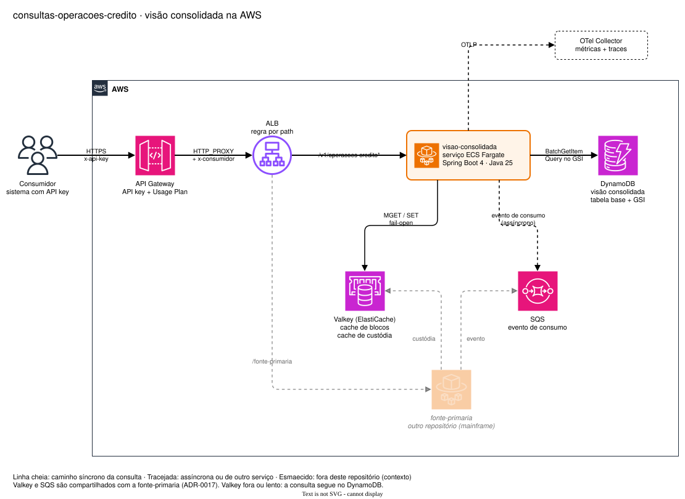

# consultas-operacoes-credito

API REST, somente leitura, de consulta de operações de crédito da Custódia de Ativos PF.
Descrição completa em `docs/prompt_detalhes_2.md`; vocabulário em `GLOSSARY.md`; decisões em `docs/adr/`.

**Versão 2.0.0** — consultas `OPERACAO`, `CLIENTE` e `CONTA` na visão consolidada (DynamoDB, com cache), com
`expand`, `fields` e `filter`, e um evento de consumo por requisição publicado no SQS. A fonte primária
(mainframe) é outro serviço, em outro repositório (ADR-0017).

| Versão | Mudança |
| --- | --- |
| 2.0.0 | Só a visão consolidada (ADR-0017): a fonte primária, `consultas.rotas-ativas` e a rota `/v1/operacoes-credito/fonte-primaria` (agora 404 neste serviço) saem para `consultas-operacoes-credito-mainframe`; o cache de custódia continua compartilhado |
| 1.4.0 | Múltiplas custódias (SF, F5, OD, NSF) com cache de custódia, paginação do mainframe, resiliência por custódia e bloco e dimensionamento ECS Fargate |
| 1.3.0 | Correções da revisão: parâmetro repetido e `conta` com mais de 20 dígitos viram 400; circuitos não contam falhas causadas pela própria API (prazo, pool, 4xx); máscara de dados pessoais nos spans; cache em comandos pequenos; ADRs 0009–0011 |
| 1.2.0 | Evento de consumo no SQS (best-effort, em lote, HMAC de CPF/CNPJ e conta); contrato em `docs/eventos/evento-consumo.md` |
| 1.1.0 | `expand` com os 9 blocos (inclui `controles_iof`), `x-blocos-indisponiveis`, catálogo de campos, massa nova |
| 1.0.0 | Esqueleto do projeto e consulta `OPERACAO` com os blocos `operacao` e `originacao` |

## Documentação visual



Fluxo de uma consulta, diagramas gerados do código, sequência com cache frio e quente e vídeo guiado em
[`docs/arquitetura/`](docs/arquitetura/README.md).

## Stack

Java 25, Spring Boot 4.2 (Spring MVC com virtual threads), AWS SDK v2 síncrono, Maven (com wrapper).
Organização hexagonal em `br.com.consultas.operacoescredito`:

| Pacote | Conteúdo |
| --- | --- |
| `domain` | `Bloco`, `TipoConsulta`, `CriterioConsulta`, `OperacaoConsultada`, o catálogo de campos em `domain.catalogo` e a seleção de campos em `domain.selecao` (sem framework) |
| `application` | Casos de uso `ConsultarOperacoesUseCase` e `RegistrarConsumoUseCase`, portas de saída `FonteDeOperacoes` e `PublicadorDeEventosDeConsumo` (sem framework) |
| `adapters.in.web` | Controller, validação dos parâmetros, Problem Details, contexto da requisição e evento de consumo |
| `adapters.out.dynamodb` | Visão consolidada (ADR-0001) |
| `adapters.out.cache` | Cache por bloco da visão consolidada no Valkey (ADR-0002) |
| `adapters.out.eventos` | Publicação do evento de consumo no SQS (ADR-0004) |
| `config` | Ligação dos casos de uso às portas; leitura do catálogo de campos |

As regras de dependência são verificadas pelo ArchUnit (`ArquiteturaTest`).

## Contrato disponível nesta versão

```
GET /v1/operacoes-credito?id_operacao=100000003&expand=parcelas,saldo,plano
x-tipo-consulta: OPERACAO
```

```
HTTP/1.1 200
x-blocos-indisponiveis: plano,saldo

{"data": [{"operacao": {...}, "originacao": {...}, "parcelas": [...], "plano": null, "saldo": null}]}
```

- `expand`: blocos separados por vírgula, com o nome canônico (o mesmo da chave no JSON e do sufixo da SK):
  `operacao`, `originacao`, `componentes`, `parcelas`, `amortizacoes`, `recebimentos`, `plano`, `saldo`,
  `controles_iof`. `operacao` e `originacao` vêm sempre; repetições e espaços em volta dos nomes são ignorados.
- Cada parâmetro do contrato (`id_operacao`, `cpf_cnpj`, `conta`, `limite_operacoes`, `expand`, `fields`,
  `filter`) vai no máximo uma vez: listas vão separadas por vírgula no mesmo parâmetro. Repetido
  (`expand=parcelas&expand=saldo`, `filter=a&filter=b`) é 400, para que dois filtros não virem um "ou" sem aviso.
- Só os blocos pedidos e fora do cache são lidos do DynamoDB (um `BatchGetItem` com uma chave por bloco).
- Bloco pedido e ainda ausente na visão consolidada: chave com `null` e o bloco listado em
  `x-blocos-indisponiveis` (ordem canônica). Blocos-lista vazios (`[]`) não são indisponíveis.
- `fields`: `bloco.campo` separados por vírgula, com ponto também para campos aninhados
  (ex.: `fields=operacao.situacao_operacao_credito,saldo.saldo_parcelas.saldo_devedor`). Bloco sem campos
  listados volta completo; `id_operacao` volta sempre, em todo item de todo nível onde existe (`fields=operacao.id_operacao`
  reduz `operacao` a `{"id_operacao": ...}`); campo composto listado inteiro volta completo. A seleção é aplicada
  pelo caso de uso ao que a fonte devolveu, então vale para qualquer rota e tipo de consulta.
- `filter`: RSQL avaliado em memória sobre o que a fonte devolveu, com seletor `<bloco>.<campo>` (caminho com
  ponto em campos aninhados) e comparação pelo tipo do catálogo. Operadores `==`, `!=`, `=lt=`/`<`, `=le=`/`<=`,
  `=gt=`/`>`, `=ge=`/`>=`, `=in=(a,b)`, `=out=(a,b)`; `;` é "e", `,` é "ou", parênteses agrupam. Ex.:
  `filter=parcelas.numero_parcela_amortizacao=ge=4;parcelas.situacao_parcela==ABERTA`.
  - Cada condição filtra só a sua lista: os itens do bloco-lista ou, em bloco-objeto, a primeira lista do
    caminho (`saldo.saldo_parcelas.saldo_devedor=gt=0`). Listas mais internas valem se algum item atende.
  - Em `operacao`/`originacao` a operação que não atende sai de `data` (consulta por operação: `{"data": []}`).
    Os dois blocos filtram o mesmo alvo (a operação), então podem ser ligados por `,` (ou):
    `operacao.situacao_operacao_credito==ATIVA,originacao.canal_contratacao==MOBILE`.
  - Campo nulo ou ausente só atende a `!=` e `=out=`; texto e booleano aceitam só `==`, `!=`, `=in=`, `=out=`.
  - 400: sintaxe inválida, bloco ou campo fora do catálogo, bloco fora do `expand`, campo composto, argumento
    fora do tipo, campo de primeiro nível de bloco-objeto que não seja `operacao`/`originacao`, ou `,` (ou)
    misturando listas diferentes.

| Situação | Status |
| --- | --- |
| Operação encontrada | 200 |
| Algum bloco pedido ausente na visão consolidada | 200 + `x-blocos-indisponiveis` |
| Operação inexistente | 404 (Problem Details) |
| `x-tipo-consulta` ausente/inválido (o detalhe lista os valores válidos, sem ecoar o recebido), `id_operacao` ausente/não numérico/com mais de 18 dígitos, parâmetro incoerente com o tipo (`cpf_cnpj`, `conta` ou `limite_operacoes` em `OPERACAO`; `id_operacao` em `CLIENTE`/`CONTA`), parâmetro do contrato repetido | 400 (Problem Details) |
| Bloco desconhecido no `expand` (inclusive maiúsculas ou item vazio) | 400 (Problem Details listando os blocos válidos) |
| `fields` malformado, com bloco desconhecido, bloco fora do `expand` (sem expansão implícita) ou campo fora do catálogo | 400 (Problem Details listando blocos ou campos válidos) |
| `CLIENTE`/`CONTA` sem operações | 200 com `{"data": []}` |
| `cpf_cnpj` que não é CPF (11 dígitos) ou CNPJ (14 caracteres, alfanumérico em maiúsculas) com DV válido; `conta` com caractere não numérico ou mais de 20 dígitos (barrada antes de virar chave no DynamoDB); `limite_operacoes` fora de 1 a 500 | 400 (Problem Details) |
| Prazo da requisição do tipo de consulta esgotado (DynamoDB lento) | 504 (Problem Details sugerindo `limite_operacoes`, menos blocos no `expand` e a consulta por `OPERACAO`) |
| Falha do DynamoDB depois do retry do SDK, ou item fora do formato (atributo ausente, `texto_detalhe` corrompido) | 502 (Problem Details) |
| Circuit breaker do DynamoDB aberto, bulkhead cheio (total ou de CLIENTE/CONTA), rate limiter interno sem permissão, pool de conexões esgotado, throttling do DynamoDB depois do retry ou `UnprocessedKeys` restantes após 3 leituras | 503 (Problem Details) + `Retry-After` em segundos |

`CLIENTE` (`cpf_cnpj`) e `CONTA` (`conta`) devolvem as operações da mais recente para a mais antiga por data
de contratação, até `limite_operacoes` (ausente: todas). A leitura segue o ADR-0001: `Query` no GSI esparso
(`ScanIndexForward=false`, `Limit` = limite, paginada), que já traz o bloco `operacao`, e `BatchGetItem` de
`originacao` + blocos pedidos em lotes de até 100 chaves, em paralelo (uma virtual thread por lote, com o MDC
propagado, no máximo `consultas.dynamodb.max-lotes-simultaneos` = 4 lotes em andamento por consulta), relendo
`UnprocessedKeys` com backoff. O primeiro lote que falhar derruba a consulta e interrompe os demais.

O bloco `operacao` ganha o campo `custodia` (`SF`, `F5`, `OD` ou `NSF`, ADR-0012), preenchido pela aplicação;
filtrável (`filter=custodia==NSF`) e selecionável (`fields`). Operação em mais de uma custódia: vale a de maior
precedência (`consultas.custodia.precedencia`, default `NSF > SF > F5 > OD`), com WARN e
`consultas.custodia.duplicada`.

### Resiliência da visão consolidada

Proteção própria do DynamoDB (instâncias `dynamodb` e `dynamodb-cliente-conta` do Resilience4j), em `ResilienciaDynamoDb`, programática (sem AOP). Valores em `resilience4j.*.instances` e
`consultas.dynamodb.*` no `application.yml`.

| Mecanismo | Regra | Resposta |
| --- | --- | --- |
| Prazo da requisição | `PrazoDaRequisicao` (`consultas.prazo.*`, ADR-0006). Cada `Query`/`BatchGetItem` leva `apiCallTimeout` = menor entre `consultas.dynamodb.timeout-chamada` (1 s) e o que resta do prazo, então tentativas e backoff do SDK nunca passam dele; a espera pelos lotes paralelos e a releitura das `UnprocessedKeys` também param no prazo; sem prazo restante, a chamada nem sai | 504 com as sugestões |
| Retry | **Só o do SDK** (modo `standard`: throttling, 5xx, falha de conexão; nunca 4xx): 2 tentativas extras, backoff exponencial com jitter de 10 ms até 50 ms, também no throttling. Cada tentativa tem teto `consultas.dynamodb.timeout-tentativa` (100 ms), para que uma tentativa presa deixe prazo para outra. Nenhum retry do Resilience4j no DynamoDB | 502 (falha) ou 504 (tempo) |
| Circuit breaker `dynamodb` | Por chamada ao SDK, depois do retry dele: janela de 50, mínimo 20, abre com 50% de falhas, 5 s aberto, 5 no meio-aberto. Contam 5xx, falhas de conexão, timeouts com o tempo inteiro, throttling e `UnprocessedKeys` restantes. **Não contam** (ADR-0010): chamadas interrompidas pela própria aplicação (lote cancelado), timeouts encurtados pelo prazo da requisição (menos de 10 ms restantes), pool de conexões esgotado e 4xx que não são throttling (`ValidationException` → 502) | 503 + `Retry-After` (tempo aberto) |
| Bulkhead `dynamodb-cliente-conta` | Só CLIENTE/CONTA: 40 consultas simultâneas, sem espera. Abaixo do total: saturar CLIENTE/CONTA não impede OPERACAO | 503 + `Retry-After: 1` |
| Bulkhead `dynamodb` | Todas as consultas: 180 simultâneas, sem espera | 503 + `Retry-After: 1` |
| Rate limiter `dynamodb` | 3000 consultas por segundo, sem fila | 503 + `Retry-After` (período do limite) |
| Lotes por consulta | `consultas.dynamodb.max-lotes-simultaneos` (4) `BatchGetItem` em andamento por consulta CLIENTE/CONTA; os demais esperam vaga dentro do prazo | 504 se o prazo acabar |
| Pool | Cliente HTTP do SDK (Apache HttpClient 5) com `consultas.dynamodb.pool.*`: 300 conexões, conexão em 100 ms, 20 ms de espera por conexão, 1 s de leitura, TTL 5 min, ociosa até 30 s. Dimensionado pelo pior caso dos bulkheads, **validado na subida**: `max-conexoes ≥ (dynamodb − dynamodb-cliente-conta) + dynamodb-cliente-conta × max-lotes-simultaneos` = (180 − 40) + 40 × 4 = 300 | 503 + `Retry-After: 1` se esgotar (sem contar no circuito) |

Bulkheads e rate limiter valem por consulta (antes de qualquer I/O, inclusive o Valkey); o circuit breaker, por
chamada ao DynamoDB. Falha do SDK depois do retry → 502; throttling depois do retry ou `UnprocessedKeys`
restantes após 3 leituras → 503 com `Retry-After: 1`; item fora do formato → 502. Métricas
`resilience4j.circuitbreaker.*`, `resilience4j.bulkhead.*` e `resilience4j.ratelimiter.*` com a tag `name`
(`dynamodb`, `dynamodb-cliente-conta`). A descoberta de custódia é medida por
`consultas.custodia.descoberta{rota,custodia,resultado}` (`encontrada`, `nao_encontrada`, `indisponivel`, `cache`).

Logs WARN (logger `resiliencia`) de todas as instâncias (DynamoDB, Valkey e SQS): toda transição de circuit
breaker, com as taxas de falha e de lentidão e os limiares; recusas (circuito aberto, bulkhead cheio, rate limiter
sem permissão) amostradas a uma linha por instância a cada 5 s, com quantas foram suprimidas.

## Cache versionado (Valkey)

Cache dos dados (blocos) da visão consolidada (ADR-0002), **versionado** (ADR-0018): uma consulta nunca entrega
blocos de versões do registro (`codigo_identificador_carga`) diferentes da mesma operação, e uma leitura atrasada
nunca regrava no cache um dado mais antigo do que o que ele já conhece.

- Hash `op:{id_operacao}:{custodia}`: campo `versao` (epoch ms), um campo por bloco (nome canônico; valor =
  `texto_detalhe` em GZIP exatamente como veio do DynamoDB) e, quando invalidado, `marcador`. TTL
  `consultas.cache.ttl` (default 5 min), definido só quando o hash é criado ou substituído, nunca renovado.
- **Cache de custódia**: hash `custodia-vc:{id_operacao}` (`custodia`, `versao`, `marcador`; TTL
  `consultas.cache.ttl-custodia`, 24 h, ADR-0012), o único que esta API lê. A chave `custodia:{id_operacao}` (só o
  código) continua sendo gravada: é contrato com o serviço da fonte primária, no mesmo Valkey, e só muda em
  conjunto (ADR-0017).
- Leitura: um `HMGET` por hash, todos em pipeline (na consulta OPERACAO, a custódia e as quatro custódias numa ida
  só). Hash com `marcador`, ou de outra versão que a do GSI (CLIENTE/CONTA), conta como ausente. Só os blocos
  ausentes vão ao `BatchGetItem`; se os lidos vierem noutra versão, a operação é relida inteira com
  `ConsistentRead` (até 2 vezes) e, se continuar divergente, a resposta é 503 (`consultas.versao_divergente`).
- Gravação **fora da requisição** (virtual thread, no máximo `max-gravacoes-simultaneas` = 32 em andamento; sem
  vaga, descartada) pelo script Lua de uma chave `ScriptValkey.GRAVAR_VERSIONADO`: versão ausente ou menor
  substitui o hash; igual completa os blocos (ex.: depois de `expand=parcelas,amortizacoes`, uma chamada
  `expand=parcelas,saldo` só lê `saldo` no DynamoDB); maior rejeita. Item sem versão (ou fora do formato ISO) é
  entregue, mas não vai ao cache.
- Invalidação: o invalidador (Lambda no DynamoDB Streams, outro repositório) grava `versao=V` e `marcador=1` no
  hash, apagando os blocos; só uma leitura com versão ≥ V volta a preenchê-lo.
- Consulta com mais de `consultas.cache.max-chaves-por-consulta` (500) blocos (operações × blocos), ou com menos de
  `prazo-minimo-restante` (20 ms) do prazo da requisição, nem lê nem grava no cache (`resultado=ignorado`).
- Só comandos de uma chave, inclusive o script: funciona com ou sem cluster mode. Valkey com
  `maxmemory-policy allkeys-lru` e alarme em `evicted_keys > 0` (nunca `volatile-ttl`, que despejaria primeiro os
  marcadores).
- Vale para `OPERACAO`, `CLIENTE` e `CONTA`. A `Query` no GSI (a lista de operações do cliente/conta, que já traz o
  bloco `operacao`) **não** é cacheada: operação nova aparece na hora. Bloco indisponível não é cacheado.
- Fail-open: o Valkey é só otimização. Timeout curto do cliente (`spring.data.redis.timeout`, 10 ms; conexão em
  `connect-timeout`, 20 ms, para que um host inalcançável custe pouco até o circuito abrir) e circuit breaker
  próprio (`resilience4j.circuitbreaker.instances.valkey`); erro, lentidão ou circuito aberto = "nada em cache"
  (`resultado=indisponivel`) e a consulta segue no DynamoDB com a mesma resposta. O Valkey não entra no
  health/readiness.
- Cliente Lettuce (Spring Data Redis) com uma conexão compartilhada e multiplexada; sem pool.
- `consultas.cache.habilitado=false` desliga o cache (toda leitura vai ao DynamoDB).

## Fonte primária (outro serviço)

`GET /v1/operacoes-credito/fonte-primaria` (mainframe, mesmo contrato) é atendida pelo serviço
`consultas-operacoes-credito-mainframe`, em outro repositório (ADR-0017). O ALB leva esse path para lá; neste
serviço ele não existe (404 em Problem Details). O API Gateway (`infra/api-gateway`) continua aqui e expõe os dois
paths. Os dois serviços compartilham, sem código em comum:
- o contrato HTTP, com o `catalogo-campos.yml` deste repositório como fonte da verdade;
- o cache de custódia no mesmo Valkey (seção anterior);
- a fila e o schema do evento de consumo, distinguidos pelo campo `rota`.

## Evento de consumo (SQS)

Cada requisição à rota de consulta, com sucesso ou erro, gera um evento de consumo publicado na fila SQS
`consultas-eventos-consumo` (ADR-0004, ADR-0008), para outro serviço levar a Firehose → S3 → Athena. Contrato
(campos, códigos de erro, evolução por `versao_evento`) em [`docs/eventos/evento-consumo.md`](docs/eventos/evento-consumo.md).
O serviço da fonte primária publica o mesmo evento na mesma fila, com `rota=fonte_primaria`.

- JSON plano em `snake_case`: `versao_evento`, `timestamp`, `correlation_id`, `trace_id`, `consumidor`, `rota`,
  `tipo_consulta`, `id_operacao`, `cpf_cnpj_hmac`, `conta_hmac`, `blocos_solicitados`, `campos_solicitados`,
  `filtro`, `limite_operacoes`, `quantidade_operacoes_retornadas`, `blocos_indisponiveis`, `cache_hits` e
  `cache_misses` por bloco, `status_http`, `codigo_erro`, `duracao_ms`.
- CPF/CNPJ e conta só como HMAC-SHA256 (hex) com `consultas.eventos.segredo-hmac`, também dentro do `filtro`
  (com ou sem pontuação: `529.982.247-25` dá o mesmo HMAC de `52998224725`); nunca em claro. Blocos e campos
  malformados ficam fora do evento. `consumidor` é o mesmo valor normalizado de logs e métricas.
- Montado no fim do `ContextoRequisicaoFilter` (`RegistroDeConsumoHttp`). Os hits e misses de cache da requisição
  são contados no `CacheDaRequisicao`, aberto pela borda HTTP e propagado às threads filhas como o MDC.
- **Best-effort e assíncrono**: a requisição só põe o evento numa fila em memória limitada
  (`consultas.eventos.fila.capacidade`, 10.000); uma virtual thread monta lotes de até 10 (ou o que houver 1 s depois
  do primeiro evento) e envia cada lote num `SendMessageBatch`, em outra virtual thread. A requisição nunca espera
  o SQS nem falha por ele.
- Fila cheia, bulkhead sem vaga, circuito aberto, falha do SQS ou encerramento → evento descartado e contado em
  `eventos.consumo.descartados` (tag `motivo`).
- Resiliência própria: circuit breaker `sqs` (janela de 20, mínimo 5, 50% de falhas, 10 s aberto), bulkhead `sqs`
  (4 envios simultâneos, espera de até 1 s por vaga), timeout por tentativa (1 s) e da chamada (3 s) e retry só do
  SDK (`standard`).
- Encerramento gracioso: depois que o servidor web para de atender, o que restou na fila é enviado por até
  `consultas.eventos.fila.tempo-maximo-drenagem` (10 s) no total, envios em andamento incluídos. Todo evento
  termina enviado ou contado: o que não sai no tempo (ou chega à fila durante o encerramento) conta como
  `encerramento`. Uma falha inesperada no drenador descarta só aquele lote (`falha_envio`) e ele segue.
- `consultas.eventos.habilitado=false` desliga o evento (nada é montado nem enviado). Ligado, `segredo-hmac` (pelo
  menos 32 bytes, ex.: `openssl rand -base64 48`) e `sqs.url-fila` são obrigatórios (a aplicação não sobe sem
  eles). O segredo nunca aparece no `toString()` das propriedades.

## Contrato HTTP (fonte da verdade)

O contrato das duas rotas (`/v1/operacoes-credito` e `/v1/operacoes-credito/fonte-primaria`) está em dois arquivos
deste repositório, escritos à mão (contract-first, sem springdoc; ADR-0017):

| Arquivo | Conteúdo | URL raw (lida pelo repositório do mainframe) |
| --- | --- | --- |
| [`contrato/openapi.yaml`](contrato/openapi.yaml) | OpenAPI 3.0.3: paths, `x-tipo-consulta`, parâmetros, `x-blocos-indisponiveis`, `x-correlationid`, corpo `{"data": [...]}` com o schema de cada bloco e os Problem Details de 400/404/429/500/502/503/504 (`Retry-After` em 429 e 503) | `https://raw.githubusercontent.com/joaopedro-techon/consultas-operacoes-credito/main/contrato/openapi.yaml` |
| [`src/main/resources/catalogo-campos.yml`](src/main/resources/catalogo-campos.yml) | Campos de cada bloco, com tipo e `anulavel` (ver [Catálogo de campos](#catálogo-de-campos)) | `https://raw.githubusercontent.com/joaopedro-techon/consultas-operacoes-credito/main/src/main/resources/catalogo-campos.yml` |

**Regra: mudou aqui primeiro, alinha o mainframe em seguida.** Toda mudança de contrato (parâmetro, header, status,
bloco ou campo) é feita neste repositório, nos dois arquivos, e entra na `main`; o CI do
`consultas-operacoes-credito-mainframe` baixa os dois da `main` em todo PR e num job diário e falha enquanto o serviço
dele divergir. Os caminhos acima são estáveis: mudar um deles quebra o CI do outro repositório.

- Os blocos são `Map` dirigidos pelo catálogo (ADR-0005), e o schema reflete isso: cada bloco lista os campos do
  catálogo com o tipo e a nulidade, mas nenhum campo de bloco é obrigatório (`fields` reduz os blocos e uma custódia
  pode não ter um campo, como a F5 sem `dependencia_contabil`) e campo fora do catálogo não é recusado
  (`additionalProperties: true`). Já o envelope é fechado: `{"data": [...]}` e, em cada operação, só as chaves dos
  blocos, com `operacao` e `originacao` sempre presentes; todo bloco, exceto `operacao`, pode vir `null`.
- `ContratoOpenApiIT` valida contra o `openapi.yaml` respostas reais da rota da visão consolidada (200 nos três
  tipos de consulta, com `expand`, `fields`, `filter` e blocos indisponíveis; 400; 404; 502), e o
  `ResilienciaVisaoConsolidadaIT` valida os 502, 503 e 504 que provoca. Validador:
  `com.atlassian.oai:openapi-request-validator-core` (antigo `swagger-request-validator`), com toda divergência
  como erro: status fora do contrato, content type, header obrigatório ausente e corpo fora do schema.
- `ContratoOpenApiCatalogoTest` garante que os dois arquivos não divergem entre si: cada bloco do catálogo tem
  `bloco.<nome>` no `openapi.yaml` com a mesma estrutura e exatamente os mesmos campos, tipos e `anulavel`.
  Incluir um campo no catálogo exige incluí-lo também no `openapi.yaml`.

## Catálogo de campos

`src/main/resources/catalogo-campos.yml` (importado pelo `application.yml`) declara, para cada bloco, a
estrutura (`objeto` ou `lista`) e os campos com nome, tipo e `anulavel` (ADR-0005). Tipos: `numero`,
`decimal`, `data` (`yyyy-MM-dd`), `data_hora` (`yyyy-MM-ddTHH:mm:ss`), `texto`, `booleano`, e os compostos
`objeto`/`lista`, que declaram os próprios campos (ex.: `plano.dados_plano_amortizacao.encargos_moratorios`,
`saldo.saldo_parcelas`). Os blocos continuam trafegando como `Map`, com decimais em `BigDecimal`.

O catálogo é validado na subida (um bloco por `Bloco`, `id_operacao` numérico em todo bloco, compostos com
subcampos, nomes únicos) e valida o `fields` e valida e tipa o `filter`. Incluir ou remover campo = editar o YAML;
o teste `CatalogoDeCamposMassaTest` garante que a massa local usa exatamente os campos e tipos do catálogo.

## Contexto da requisição e logs

Um filtro (`ContextoRequisicaoFilter`) roda antes de qualquer processamento em toda rota fora de `/actuator`:

| Header | Regra |
| --- | --- |
| `x-correlationid` | Até 64 caracteres `[A-Za-z0-9-]`. Ausente: UUID gerado. Inválido: 400 (com um UUID novo). Sempre devolvido na resposta |
| `x-consumidor` | Sem espaços nas pontas. Ausente: `desconhecido`. Fora de `[A-Za-z0-9._-]{1,64}`: `invalido` (o valor recebido não vai a log, evento nem métrica) |

- `correlation_id`, `consumidor`, `tipo_consulta` (ou `invalido`) e `rota` vão para o MDC e, ao final, só essas
  chaves são removidas (as do tracing, como `traceId`/`spanId`, ficam com quem as pôs). Todo Problem Details traz a
  propriedade `correlation_id`.
- Rota, consumidor, tipo de consulta e blocos pedidos são lidos por uma única regra (`RequisicaoDeConsulta`) para
  MDC, log de acesso, evento de consumo, prazo e métricas; só a rota exata `/v1/operacoes-credito` gera evento
  e conta em `consultas.blocos`, sempre com `rota=visao_consolidada`.
- Logs em JSON (structured logging ECS do Spring Boot) por um `AsyncAppender` (`logback-spring.xml`).
  Perfil `human-logs` para texto legível em desenvolvimento.
- Um log de acesso por requisição (logger `acesso`): `metodo`, `uri`, `blocos`, `status`, `duracao_ms`,
  `cache_hits` e `cache_misses` por bloco (objeto `bloco → quantidade`, vazio com o cache
  desligado), parâmetros informados (`id_operacao`, `cpf_cnpj`, `conta`, `limite_operacoes`, `fields`, `filter`)
  e o MDC.
- CPF/CNPJ e conta saem sempre mascarados (`529******25`, `***********5874`) em todo log: campos com esses
  nomes, segmentos de rota `/clientes/<cpf_cnpj>` e `/contas/<conta>` (URLs com o documento ou a conta no caminho), pares
  `chave=valor`/RSQL/JSON e CPF/CNPJ soltos com DV válido (`MascaramentoLogCustomizer`).
- O MDC chega às threads filhas por Micrometer Context Propagation (`MdcThreadLocalAccessor`): envolver a
  tarefa com `ContextSnapshotFactory.captureAll().wrap(...)` ou o executor com `ContextExecutorService.wrap(...)`.

## Métricas e traces

Micrometer + OpenTelemetry (`spring-boot-starter-opentelemetry`): a aplicação exporta métricas
(`OtlpMeterRegistry`) e traces (bridge Micrometer Tracing → OpenTelemetry SDK) por OTLP/HTTP para o
OpenTelemetry Collector, que manda métricas ao Prometheus e traces ao Jaeger. Nada de fornecedor no código:
trocar para Datadog é trocar o exporter em `observabilidade/otel-collector.yaml`.

| Métrica | Tags |
| --- | --- |
| `http.server.requests` (timer) | `consumidor`, `tipo_consulta` (`nenhum`/`invalido` quando ausente/inválido), `rota`, `status`, `uri` (template), `method`, `outcome`, `exception` |
| `consultas.blocos` (contador, um incremento por bloco pedido) | `bloco`, `consumidor`, `tipo_consulta`, `rota`, `status` |
| `consultas.dependencia` (timer, um por chamada externa) | `dependencia` (`dynamodb`, `valkey`, `sqs`), `operacao` (`BatchGetItem`, `Query`... no DynamoDB; `HMGET`/`EVALSHA`/`DEL` no Valkey; `SendMessageBatch` no SQS), `indice` (GSI ou `nenhum`, só DynamoDB) |
| `consultas.cache` (contador, um incremento por bloco procurado no cache) | `bloco`, `resultado` (`hit`, `miss`; `indisponivel` com o Valkey fora, lento ou o circuito aberto; `ignorado` quando a consulta pula o cache por ter blocos demais ou pouco prazo). Taxa de acerto = `hit / (hit + miss)`; o evento de consumo continua só com hits e misses |
| `resilience4j.circuitbreaker.*` (estado, chamadas) | `name` (`valkey`, `dynamodb`, `sqs`), `state`/`kind` |
| `resilience4j.bulkhead.*`, `resilience4j.ratelimiter.*` | `name` (`dynamodb`, `dynamodb-cliente-conta`; bulkhead também `sqs`) |
| `eventos.consumo.enviados` (contador; Prometheus `eventos_consumo_enviados_total`) | — |
| `eventos.consumo.descartados` (contador; Prometheus `eventos_consumo_descartados_total`) | `motivo` (`fila_cheia`, `bulkhead_cheio`, `circuito_aberto`, `falha_envio`, `encerramento`) |
| `eventos.consumo.fila` (gauge, eventos aguardando envio) | — |
| `consultas.etapa` (timer, um por etapa interna) | `etapa` (`consulta_gsi`, `batch`, `filtro`); `indice` em `consulta_gsi` |

- `x-consumidor` vira tag como veio (id da API key no gateway); fora de `[A-Za-z0-9._-]{1,64}` vira `invalido`.
  Bloco fora do catálogo não vira tag. `id_operacao`, CPF/CNPJ e conta nunca são tag de métrica.
- Spans: um por requisição HTTP (com `consumidor`, `tipo_consulta`, `rota`, `correlation_id` e os
  identificadores da consulta), com filhos por etapa e por chamada externa. `traceparent` (W3C) recebido
  continua o trace.
  - OPERACAO na visão consolidada: `valkey HMGET`, `dynamodb BatchGetItem` (só com blocos fora do cache) e
    `valkey EVALSHA` filho do span HTTP, mas fora da requisição (pode terminar depois da resposta).
  - CLIENTE/CONTA: `consulta_gsi` (com os `dynamodb Query`) e `batch` (com os `dynamodb BatchGetItem` dos lotes).
  - `filtro`, quando há `filter`.
- Novos adapters (Valkey, SQS) e etapas usam `Observacoes.dependencia(...)` e `Observacoes.etapa(...)`
  (`config.observabilidade`), que fixam nomes e tags. A camada de aplicação mede etapas pela porta
  `ObservadorDeEtapas`, sem depender de Micrometer.
- CPF/CNPJ e conta saem mascarados em tudo o que o span leva de texto: nome, atributos, eventos (inclusive
  `exception.message` e `exception.stacktrace`, que podem trazer uma URL com o documento ou a conta) e
  descrição do status (`MascaramentoSpanExporter`, que envolve todo exportador de span). O Collector mascara de
  novo, como defesa em profundidade (processor `transform/mascaramento`).
- Buckets de histograma nos prazos do requisito não funcional (`management.metrics.distribution.slo`).
- A aplicação amostra 100%; o **tail sampling** do Collector guarda todo trace com erro, com status 5xx ou
  lento (OPERACAO > 80 ms, CLIENTE/CONTA > 200 ms) e 10% do resto.
- `/actuator/metrics` exposto para inspeção.

## Subir o ambiente local

Pré-requisito: Docker.

```bash
docker compose up -d --build --wait
curl -H "x-tipo-consulta: OPERACAO" "http://localhost:8080/v1/operacoes-credito?id_operacao=100000001"
docker compose down -v
```

O `docker-compose.yml` sobe:

- **LocalStack Community `4.14.0`**, a última tag que roda sem auth token (ADR-0003). Uso exclusivo em
  desenvolvimento local: a tag não recebe patches de segurança. Serviços `dynamodb` e `sqs`.
- **Valkey `9.0.8-alpine`** (porta 6379), cache versionado, sem persistência.
- **app**, construída pelo `Dockerfile`.
- **OpenTelemetry Collector** `otel/opentelemetry-collector-contrib:0.165.0` (OTLP em `4317`/`4318`).
- **Jaeger v2** `jaegertracing/jaeger:2.23.0`: traces em http://localhost:16686.
- **Prometheus** `prom/prometheus:v3.16.0`: http://localhost:9090.
- **Grafana** `grafana/grafana:13.3.1`: http://localhost:3000 (anônimo, somente leitura; `admin`/`admin`
  para editar). Datasources Prometheus e Jaeger e o dashboard *Consultas de Operações de Crédito*
  (latência por tipo de consulta e rota, latência por dependência, erros, blocos mais pedidos, consumo
  por consumidor) são provisionados de `observabilidade/grafana/`.

O script `localstack/init/ready.d/00-eventos-consumo.sh` cria a fila SQS `consultas-eventos-consumo` dos eventos
de consumo; para ver os eventos: `docker compose exec localstack awslocal sqs receive-message --queue-url
http://localhost:4566/000000000000/consultas-eventos-consumo --max-number-of-messages 10`.

O script `localstack/init/ready.d/01-visao-consolidada.sh` cria a tabela `operacoes-credito`
(PK `numero_operacao`, SK `custodia_expand`), os GSIs esparsos `gsi-cliente` e `gsi-conta`
(SK `sk_gsi` = `<data_contratacao_operacao>#<numero_operacao>`, projeção `ALL`) e carrega a massa de
`localstack/massa/<numero_operacao>/`: um diretório por custódia (`SF`, `F5`, `OD`, `NSF`) com um
`<BLOCO>.json` por bloco, gravado em GZIP no `texto_detalhe` com a SK `<CUSTODIA>#EXPAND#<BLOCO>`, e
`indices.env` com os atributos dos GSIs, que vão só no item `OPERACAO` de cada custódia (uma operação
duplicada aparece duas vezes no GSI).

Para ver a tabela no **NoSQL Workbench**: *Operation builder* → *Add connection* → *DynamoDB local*, host
`localhost`, porta `4566`. O Workbench assina com a região `localhost`; o LocalStack do compose roda com
`DYNAMODB_SHARE_DB=1` (um só DynamoDB para qualquer região), por isso a tabela criada em `sa-east-1` aparece.

Para ver o **cache no Valkey**: **RedisInsight** `redis/redisinsight:3.8.0` em http://localhost:5540. No primeiro
acesso, aceite os termos; a conexão *valkey (cache local)* aparece pré-configurada, com descompressão GZIP, então
cada campo de bloco do hash `op:{id_operacao}:{custodia}` mostra o JSON do bloco (escolha o formatador *JSON*), ao
lado de `versao` e do TTL restante.

A massa é gerada por `localstack/gerar_massa.py` a partir de uma especificação curta por operação, para que
os blocos fechem entre si (regras no cabeçalho do script: amortizações aplicadas juros antes do principal,
saldo = principal + juros - amortizado, IOF dos componentes = soma dos controles de IOF etc.). Para incluir
uma operação, acrescente uma entrada em `OPERACOES` (com `custodias`) e rode `python localstack/gerar_massa.py`.

| `id_operacao` | Custódia | Situação | CPF/CNPJ | Conta | Cenário |
| --- | --- | --- | --- | --- | --- |
| 100000001 | SF | ATIVA | 52998224725 | 434115000065874 | 12 parcelas, 5 pagas, parcela 6 com amortização parcial e 2 dias de atraso |
| 100000002 | SF | LIQUIDADA | 52998224725 | 434115000065874 | antecipação liquidando 3 parcelas (`BAIXA_INTEGRAL_MAIS_UMA_PARCELA`) |
| 100000003 | F5 | ATIVA | 52998224725 | 434115000099991 | sem recebimentos; **sem os blocos `plano` e `saldo`**; sem `dependencia_contabil` (F5) |
| 100000004 | OD | ATIVA | 12ABC34501DE35 (CNPJ alfanumérico) | 434115000077712 | 10 parcelas, 3 pagas |
| 100000005 | NSF | LIQUIDADA | 12ABC34501DE35 | 434115000077712 | 4 parcelas pagas no vencimento |
| 100000006 | SF **e** NSF | ATIVA (SF) / `ATIVA_NSF` (NSF) | 11144477735 | 434115000088823 | 8 parcelas, 2 pagas; **duplicada**: mesmos blocos nas duas custódias, só a situação muda; a NSF vence (precedência NSF > SF > F5 > OD) |
| 100000007 | F5 | ATIVA | 39053344705 | 434115000070007 | 75 parcelas, 34 pagas no vencimento (blocos-lista grandes) |
| 100000101 a 100000114 | rodízio SF, F5, OD, NSF (101 SF, 102 F5, 103 OD, 104 NSF, 105 SF...) | ATIVA | 11222333000181 | 434115000055501 | 14 operações mensais (2025-09-03 a 2026-10-03), 2 parcelas, sem recebimentos; as F5 sem `dependencia_contabil` |

O cliente 52998224725 tem três operações em duas contas (SF e F5); a conta 434115000065874 e a
434115000077712 têm duas operações cada. O cliente 11222333000181 (e a conta 434115000055501) tem 14
operações nas quatro custódias: com todos os blocos no `expand`, o `BatchGetItem` passa de 100 chaves e é
dividido em lotes.

Para rodar a aplicação fora do Docker contra o LocalStack do compose:

```bash
docker compose up -d --wait localstack
CONSULTAS_DYNAMODB_ENDPOINT=http://localhost:4566 AWS_REGION=sa-east-1 \
CONSULTAS_DYNAMODB_CREDENCIAIS_ACCESS_KEY_ID=test CONSULTAS_DYNAMODB_CREDENCIAIS_SECRET_ACCESS_KEY=test \
CONSULTAS_EVENTOS_SQS_ENDPOINT=http://localhost:4566 \
CONSULTAS_EVENTOS_SQS_URL_FILA=http://localhost:4566/000000000000/consultas-eventos-consumo \
CONSULTAS_EVENTOS_SQS_CREDENCIAIS_ACCESS_KEY_ID=test CONSULTAS_EVENTOS_SQS_CREDENCIAIS_SECRET_ACCESS_KEY=test \
CONSULTAS_EVENTOS_SEGREDO_HMAC=segredo-local-somente-desenvolvimento \
./mvnw spring-boot:run
```

(Ou `CONSULTAS_EVENTOS_HABILITADO=false` no lugar das variáveis `CONSULTAS_EVENTOS_*`, sem evento de consumo.)

## Configuração

| Propriedade | Variável | Default |
| --- | --- | --- |
| `consultas.dynamodb.tabela` | `CONSULTAS_DYNAMODB_TABELA` | `operacoes-credito` |
| `consultas.dynamodb.regiao` | `AWS_REGION` | `sa-east-1` |
| `consultas.dynamodb.endpoint` | `CONSULTAS_DYNAMODB_ENDPOINT` | vazio (endpoint da AWS) |
| `consultas.dynamodb.credenciais.*` | `CONSULTAS_DYNAMODB_CREDENCIAIS_ACCESS_KEY_ID` / `..._SECRET_ACCESS_KEY` | vazio (cadeia padrão do SDK) |
| `consultas.cache.habilitado` | `CONSULTAS_CACHE_HABILITADO` | `true` |
| `consultas.cache.ttl` | `CONSULTAS_CACHE_TTL` | `5m` |
| `spring.data.redis.host` / `.port` (Valkey) | `CONSULTAS_VALKEY_HOST` / `CONSULTAS_VALKEY_PORTA` | `localhost` / `6379` |
| `spring.data.redis.timeout` (comando no Valkey) | `CONSULTAS_VALKEY_TIMEOUT` | `10ms` |
| `spring.data.redis.connect-timeout` | `CONSULTAS_VALKEY_CONNECT_TIMEOUT` | `20ms` |
| `consultas.cache.chaves-por-comando` / `.max-chaves-por-consulta` / `.prazo-minimo-restante` / `.max-gravacoes-simultaneas` | `CONSULTAS_CACHE_MAX_CHAVES_POR_CONSULTA` (`max-chaves-por-consulta`) | `100` / `500` / `20ms` / `32` |
| `consultas.dynamodb.timeout-chamada` | — | `1s` (teto de uma chamada ao SDK com as tentativas; numa requisição, limitado ao prazo restante) |
| `consultas.dynamodb.timeout-tentativa` | `CONSULTAS_DYNAMODB_TIMEOUT_TENTATIVA` | `100ms` (teto de cada tentativa do SDK) |
| `consultas.dynamodb.pool.*` | `CONSULTAS_DYNAMODB_MAX_CONEXOES` (`max-conexoes`) | `max-conexoes` 300 (validado contra os bulkheads na subida), `timeout-conexao` 100ms, `timeout-obter-conexao` 20ms, `timeout-resposta` 1s, `ttl` 5m, `max-ociosa` 30s |
| `consultas.dynamodb.retry.*` | — | `tentativas-extras` 2, `backoff-base` 10ms, `backoff-maximo` 50ms (retry do SDK, modo standard) |
| `resilience4j.circuitbreaker.instances.dynamodb.*` | — | janela `COUNT_BASED` de 50, mínimo 20 chamadas, 50% de falhas, 5s aberto, 5 chamadas no meio-aberto |
| `resilience4j.bulkhead.instances.dynamodb.*` / `.dynamodb-cliente-conta.*` | — | `max-concurrent-calls` 180 / 40, `max-wait-duration` 0ms |
| `consultas.dynamodb.max-lotes-simultaneos` | `CONSULTAS_DYNAMODB_MAX_LOTES_SIMULTANEOS` | `4` (lotes de `BatchGetItem` em andamento por consulta CLIENTE/CONTA) |
| `resilience4j.ratelimiter.instances.dynamodb.*` | — | `limit-for-period` 3000 por `1s`, `timeout-duration` 0s |
| `resilience4j.circuitbreaker.instances.valkey.*` | — | janela de 20 chamadas, mínimo 10, abre com 50% de falhas, 5 s aberto, 3 chamadas em meio-aberto |
| `consultas.prazo.operacao` / `.cliente` / `.conta` | `CONSULTAS_PRAZO_OPERACAO` / `_CLIENTE` / `_CONTA` | `150ms` / `400ms` / `400ms` (prazo da requisição → 504) |
| `consultas.eventos.habilitado` | `CONSULTAS_EVENTOS_HABILITADO` | `true` |
| `consultas.eventos.segredo-hmac` | `CONSULTAS_EVENTOS_SEGREDO_HMAC` | vazio (obrigatório com o evento ligado; em produção, de um cofre de segredos) |
| `consultas.eventos.fila.capacidade` | `CONSULTAS_EVENTOS_CAPACIDADE_FILA` | `10000` |
| `consultas.eventos.fila.tamanho-lote` / `.intervalo-envio` / `.tempo-maximo-drenagem` | — | `10` (1 a 10) / `1s` / `10s` |
| `consultas.eventos.sqs.url-fila` | `CONSULTAS_EVENTOS_SQS_URL_FILA` | vazio (obrigatório com o evento ligado) |
| `consultas.eventos.sqs.endpoint` | `CONSULTAS_EVENTOS_SQS_ENDPOINT` | vazio (endpoint da AWS) |
| `consultas.eventos.sqs.regiao` | `AWS_REGION` | `sa-east-1` |
| `consultas.eventos.sqs.credenciais.*` | `CONSULTAS_EVENTOS_SQS_CREDENCIAIS_ACCESS_KEY_ID` / `..._SECRET_ACCESS_KEY` | vazio (cadeia padrão do SDK) |
| `consultas.eventos.sqs.timeout-tentativa` / `.timeout-chamada` | — | `1s` / `3s` |
| `resilience4j.circuitbreaker.instances.sqs.*` | — | janela `COUNT_BASED` de 20, mínimo 5 chamadas, 50% de falhas, 10s aberto, 2 chamadas no meio-aberto |
| `resilience4j.bulkhead.instances.sqs.*` | — | `max-concurrent-calls` 4, `max-wait-duration` 1s |
| Endpoint OTLP (traces e métricas) | `OTEL_EXPORTER_OTLP_ENDPOINT` | `http://localhost:4318` (só métricas; traces só com a variável) |
| `management.opentelemetry.resource-attributes.deployment.environment.name` | `CONSULTAS_AMBIENTE` | `local` |

## Testes

```bash
./mvnw verify
```

Requer JDK 25 e Docker. `verify` roda:

- testes unitários e ArchUnit (Surefire);
- testes HTTP de caixa-preta `*IT` (Failsafe), com a aplicação inteira e o LocalStack via Testcontainers,
  usando a mesma imagem, o mesmo script de init e a mesma massa do docker-compose (`RotaUnicaIT` confere que
  só a visão consolidada sobe e que `/v1/operacoes-credito/fonte-primaria` é 404 aqui);
  `ResilienciaVisaoConsolidadaIT` põe o LocalStack atrás de um Toxiproxy
  (`VisaoConsolidadaComToxiproxyContainers`, contexto próprio) e atrasa ou derruba o proxy para o 504 no
  prazo de cada tipo de consulta, o circuit breaker abrindo (503 + `Retry-After`), o rate limiter (503) e o
  isolamento do bulkhead de CLIENTE/CONTA em relação a OPERACAO. `DynamoDbConfigTest` conta, num servidor HTTP
  local, as tentativas do retry do SDK (3 em 5xx e throttling, 1 em 4xx).
  O cache fica desligado nos testes (`src/test/resources/application.properties`), exceto no `CacheIT`, que sobe
  o Valkey atrás de um Toxiproxy (`CacheContainers`): altera itens no DynamoDB depois da primeira chamada para
  saber de onde veio cada bloco, lê o Valkey direto pela porta do container e derruba ou atrasa o proxy para
  verificar o fail-open e o circuit breaker.
- O evento de consumo fica desligado nos testes (`consultas.eventos.habilitado=false`), exceto no
  `EventoDeConsumoIT` (`EventosDeConsumoContainers`), que lê a fila do LocalStack com o SDK e confere cada evento
  (HMAC, nenhum dado em claro, hits/misses de cache com o Valkey, erros, `trace_id`) e sobe uma segunda instância
  da aplicação para ver a fila em memória drenada no encerramento, e no `EventoDeConsumoSqsForaIT`, em que o SQS é
  um socket que nunca responde: a consulta segue igual e rápida e os eventos são descartados e contados.
- Nos testes, os prazos por tipo de consulta são de 10 s e o circuito do DynamoDB só abre com 1000
  chamadas (`src/test/resources/application.properties`), para que containers frios e falhas provocadas de
  propósito não afetem outros testes; os testes de resiliência usam contexto próprio com valores pequenos.

O CI (`.github/workflows/ci.yml`, actions fixadas por SHA do commit) executa `./mvnw -B verify`, valida o
docker-compose e o Collector, constrói a imagem Docker e, num job à parte, roda `terraform fmt -check` e
`terraform init -backend=false` + `terraform validate` em `infra/api-gateway`. A imagem parte de bases Temurin
fixadas por tag exata e digest, roda como o usuário numérico `10001` e termina o processo em `OutOfMemoryError`
(`-XX:+ExitOnOutOfMemoryError`).
