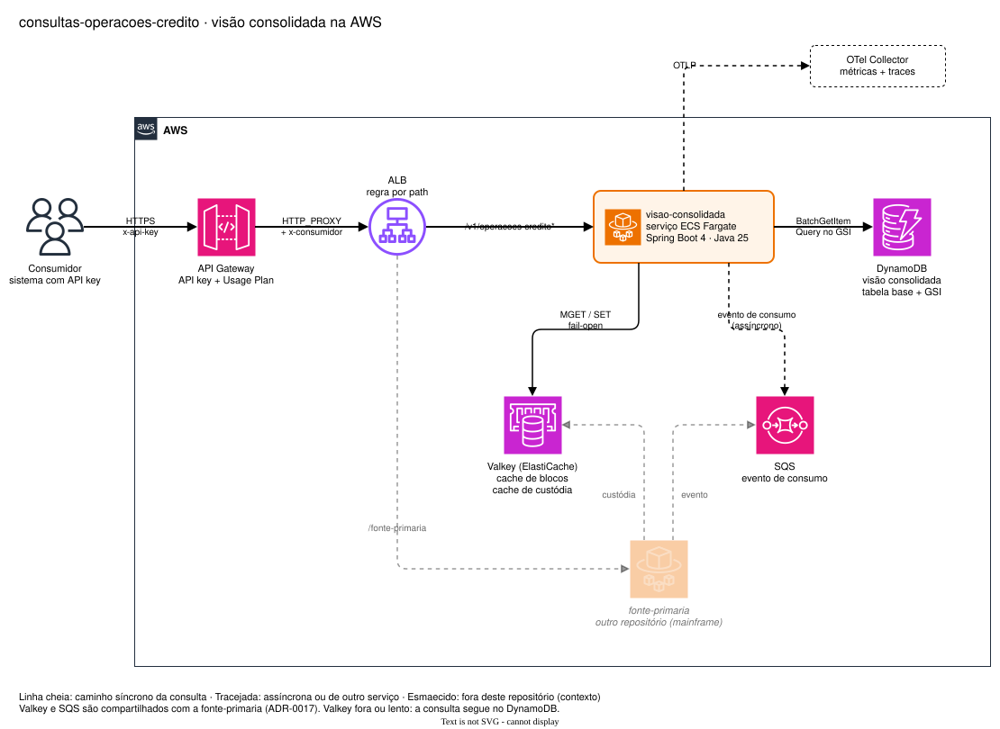
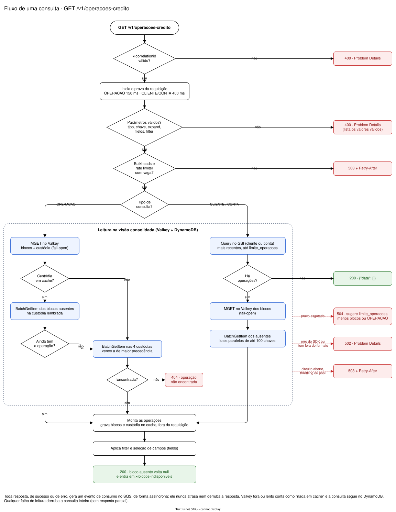

# Documentação visual

Diagramas do serviço da **visão consolidada** (`consultas-operacoes-credito`): uma API só de leitura que devolve
operações de crédito da visão consolidada (DynamoDB), com cache de blocos e cache de custódia no Valkey. Os termos
seguem o [`GLOSSARY.md`](../../GLOSSARY.md). A fonte primária (mainframe) é outro serviço, em outro repositório
(ADR-0017), e aparece aqui só como contexto, esmaecida.

## Visão geral na AWS

Componentes e o caminho da consulta: consumidor → API Gateway (API key) → ALB → serviço ECS `visao-consolidada`
→ Valkey, DynamoDB e SQS.



## Fluxo de uma consulta

Validações, prazo da requisição, tipo de consulta, cache e leitura no DynamoDB, e todos os desfechos (200, 400,
404, 502, 503 e 504).



## Arquitetura (archify, a partir do código)

O mesmo sistema, gerado pela archify com cada componente ligado ao código-fonte. A versão interativa
([`arquitetura.html`](arquitetura.html)) tem a story guiada e mostra o trecho de código de cada componente.


**Vídeo (52 s, WebM):** [`arquitetura-story.webm`](arquitetura-story.webm), a story guiada sobre esse diagrama:
o que o serviço faz e o caminho de uma consulta.

## Sequência de uma consulta OPERACAO

A primeira consulta (cache frio: descoberta de custódia nas quatro custódias) e a seguinte (cache quente: custódia
e blocos no mesmo `MGET`, sem DynamoDB). Versão interativa: [`sequencia-operacao.html`](sequencia-operacao.html).


## Como editar e regenerar

| Artefato | Fonte | Como atualizar |
| --- | --- | --- |
| `visao-geral.svg`, `fluxo-consulta.svg` | `visao-geral.drawio`, `fluxo-consulta.drawio` | Abra o `.drawio` no draw.io (desktop ou [app.diagrams.net](https://app.diagrams.net)). O `.svg` também abre direto no draw.io, porque traz o XML do diagrama embutido. Depois de editar, exporte em *Arquivo › Exportar como › SVG* com *Incluir uma cópia do meu diagrama* marcado e o tema automático, e salve por cima do `.svg` |
| `arquitetura.html`, `arquitetura.svg` | `fontes/arquitetura.archify.json`, `fontes/arquitetura.story.json` | Comandos da archify abaixo |
| `sequencia-operacao.html`, `sequencia-operacao.svg` | `fontes/sequencia-operacao.archify.json` | Comandos da archify abaixo |
| `arquitetura-story.webm` | `fontes/arquitetura.story.json` sobre `arquitetura.html` sem story | Comando `story video` abaixo |

As fontes da archify fixam o commit do código em `meta.repository.revision`, e cada componente cita arquivos e
linhas desse commit. Ao mudar o código, atualize a revisão e as linhas citadas: o `finalize` confere as citações e
falha se não baterem.

Comandos (PowerShell, na raiz do repositório; `$archify` é o caminho da CLI da archify, por exemplo
`~/.claude/skills/archify/bin/archify.mjs`). A archify escreve os intermediários em `.archify/`, que fica fora do
git:

```powershell
$archify = "$HOME\.claude\skills\archify\bin\archify.mjs"
$exportar = Join-Path (Split-Path $archify) 'export-svg.mjs'

# Arquitetura: HTML, story e SVG estático
node $archify finalize architecture docs/arquitetura/fontes/arquitetura.archify.json .archify/arquitetura/visao-consolidada.html --repo-root . --quality showcase
node $archify story attach .archify/arquitetura/visao-consolidada.html docs/arquitetura/fontes/arquitetura.story.json docs/arquitetura/arquitetura.html
node $exportar .archify/arquitetura/visao-consolidada.html docs/arquitetura/arquitetura.svg auto

# Vídeo da story (WebM, 1080p, 30 fps)
node $archify story video .archify/arquitetura/visao-consolidada.html docs/arquitetura/fontes/arquitetura.story.json docs/arquitetura/arquitetura-story.webm --format webm --fps 30

# Sequência OPERACAO: HTML e SVG estático
node $archify finalize sequence docs/arquitetura/fontes/sequencia-operacao.archify.json .archify/sequencia/consulta-operacao.html --repo-root . --quality showcase
Copy-Item .archify/sequencia/consulta-operacao.html docs/arquitetura/sequencia-operacao.html
node $exportar .archify/sequencia/consulta-operacao.html docs/arquitetura/sequencia-operacao.svg auto
```

O `export-svg.mjs` e o `story video` usam o Chrome (ou o Edge) instalado. O `export-svg.mjs` não sobrescreve um
arquivo existente: apague o `.svg` antigo antes. Rodar o `finalize` de novo no mesmo HTML pede `--out-dir`
(por exemplo, `--out-dir .archify/arquitetura/review-2`) para os recibos da nova verificação.
